# Detecting metastatic tissue in lymph node patches (PatchCamelyon)

A student portfolio project comparing a small CNN trained from scratch with a fine-tuned, ImageNet-pretrained ResNet18 on the PatchCamelyon (PCam) benchmark. **This is a research exercise on image patches. It is not a diagnostic tool.**

## The question
Can a convolutional neural network tell whether the center of a small lymph node pathology image contains metastatic (tumor) tissue? And does transfer learning (a pretrained ResNet18) beat a small network trained from scratch?

## The data
[PatchCamelyon (PCam)](https://github.com/basveeling/pcam): 327,680 color patches, 96x96 px, each with a binary label (tumor tissue present in the center region or not). The fixed splits were used exactly as provided: 262,144 train / 32,768 validation / 32,768 test. The test set was never used for training, model selection, or tuning; it was scored once per model at the end.

| split | images | negative | positive | % positive |
|---|---|---|---|---|
| train | 262,144 | 131,072 | 131,072 | 50.00 |
| validation | 32,768 | 16,399 | 16,369 | 49.95 |
| test | 32,768 | 16,391 | 16,377 | 49.98 |

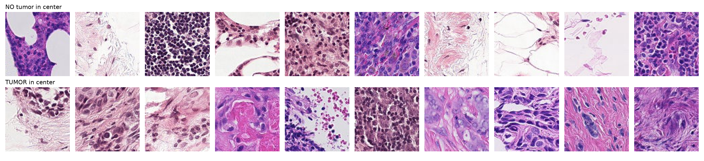

**No data is committed to this repo.** To download it (about 7.5 GB). I used Python 3.12; when I built this, `h5py` had no prebuilt package for Python 3.15:
```
pip install -r requirements.txt
python scripts/download_data.py --root data
```
This uses `torchvision.datasets.PCAM` (Google Drive). The script unpacks the archives in small chunks, because torchvision's default loads the whole 7 GB file into memory.

## Methods
- **CNN:** 4 blocks of conv, batch-norm, ReLU and max-pool, then global average pooling and one output. 241,313 parameters, random initialization.
- **ResNet18:** torchvision's ImageNet weights, final layer replaced with a single output; all layers fine-tuned (11,177,025 parameters).
- **Training:** full 262,144-image training set, 6 epochs, batch size 128, AdamW (weight decay 1e-4), cosine learning-rate schedule, learning rate 1e-3 (CNN) and 3e-4 (ResNet18), binary cross-entropy, seed 42. No hyperparameter search.
- **Augmentation (training only):** random horizontal/vertical flips, random 90-degree rotations, mild brightness/contrast/saturation jitter.
- **Model selection:** the epoch with the highest *validation* AUC. That was epoch 5 for the CNN and epoch 2 for ResNet18.
- **Decision threshold:** two are reported. (a) 0.5, fixed in advance. (b) A threshold chosen on the *validation* set by a rule fixed beforehand: the highest threshold with at least 90% validation sensitivity (0.254 for the CNN, 0.176 for ResNet18). It was then applied unchanged to the test set.
- **Confidence intervals:** 95% bootstrap intervals for AUC, from 2,000 resamples of the test patches. These capture patch-sampling variability only. They do not capture training randomness (one seed per model) or the fact that patches from the same slide are not independent.
- **Reproducibility:** seeds are fixed. Re-running the same training twice on the same Mac produced identical loss and validation AUC for the epochs I compared (1 and 2), but GPU runs are not guaranteed to be bit-for-bit identical on other hardware.
- **Where it was run:** locally on an Apple M3 (8 GB RAM) with the PyTorch MPS backend, using `scripts/run_local.sh`.

## Results
All numbers below come from `results/metrics.csv`, scored on the 32,768-patch test set.

| model | test AUC (95% CI) | calibration error (ECE) | selected epoch | validation AUC |
|---|---|---|---|---|
| CNN from scratch | 0.9488 (0.9466-0.9510) | 0.067 | 5 of 6 | 0.9577 |
| ResNet18 (ImageNet-pretrained, fine-tuned) | 0.9319 (0.9293-0.9346) | 0.111 | 2 of 6 | 0.9605 |

Operating points on the test set:

| model | threshold | accuracy | sensitivity | specificity | TP | FN | TN | FP |
|---|---|---|---|---|---|---|---|---|
| CNN from scratch | 0.5 (fixed in advance) | 86.2% | 77.2% | 95.2% | 12,642 | 3,735 | 15,599 | 792 |
| CNN from scratch | 0.254 (chosen on validation) | 87.9% | 86.8% | 89.0% | 14,213 | 2,164 | 14,586 | 1,805 |
| ResNet18 | 0.5 (fixed in advance) | 84.7% | 73.3% | 96.1% | 11,998 | 4,379 | 15,747 | 644 |
| ResNet18 | 0.176 (chosen on validation) | 86.9% | 83.1% | 90.7% | 13,615 | 2,762 | 14,870 | 1,521 |

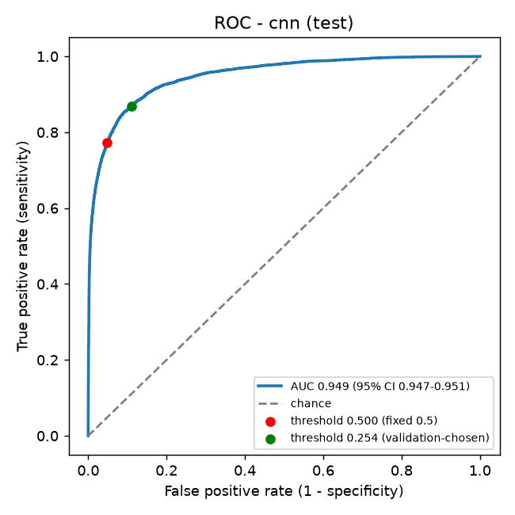
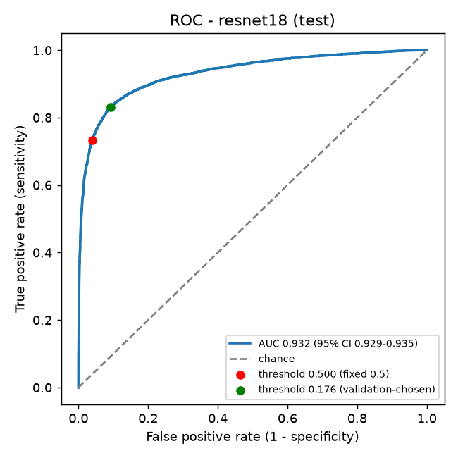

What the output shows:
- **The small CNN scored higher than ResNet18 on the test set** (AUC 0.949 vs 0.932; the intervals do not overlap). On the validation set the order was reversed (0.958 vs 0.961). So in this experiment, transfer learning did not give a better test result. This is one training run per model, so I do not draw a general conclusion from it.
- **Both models scored lower on test than on validation**, ResNet18 by more (about 0.03 AUC vs 0.01). I do not know why. Possible explanations I did not test: differences between the validation and test slides, noise in choosing the epoch, or larger-model sensitivity to such differences.
- **The validation-chosen threshold did not deliver its target on test.** It reached 90.0% sensitivity on validation but 86.8% (CNN) and 83.1% (ResNet18) on test.
- **Sensitivity is much lower than specificity at 0.5** for both models: they miss more tumor patches than they falsely flag.
- **Calibration is imperfect.** Both models are underconfident for the tumor class at low scores, and the ResNet18 more so (ECE 0.111 vs 0.067).

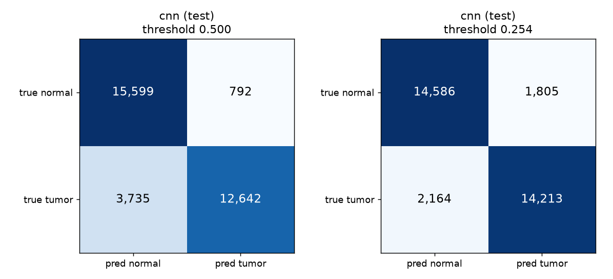
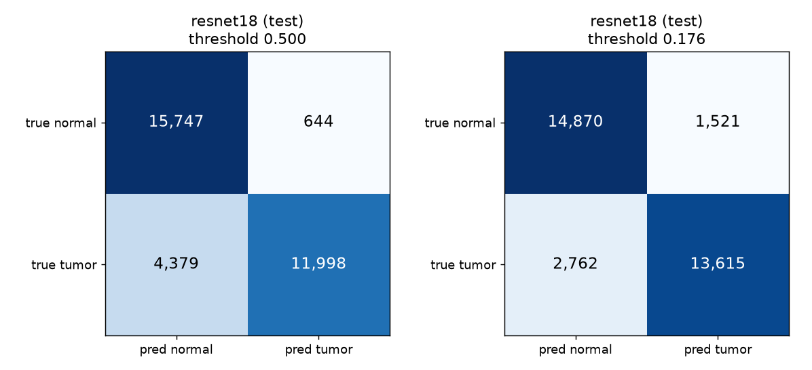
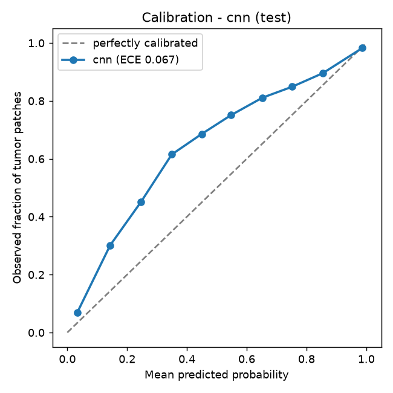
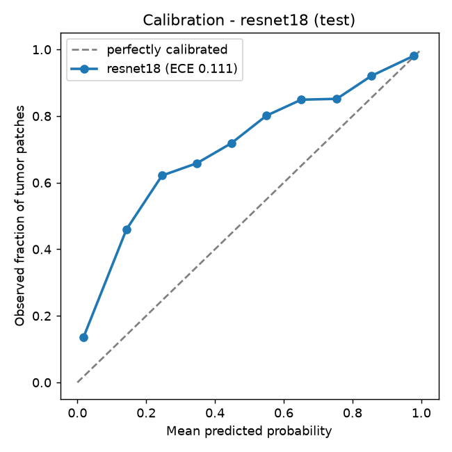

### Misclassified patches
Twelve random misclassified test patches per model (6 missed tumors, 6 false alarms; threshold 0.5). This is my visual impression, not a pathologist's review. Missed tumors tended to be at tissue edges next to empty space, loose or sparse cells, or dense small cells. False alarms were often dense sheets of dark round nuclei, and a few confidently flagged patches looked like artifacts (a streaked, blurry patch; a fibrous patch with blue stain).

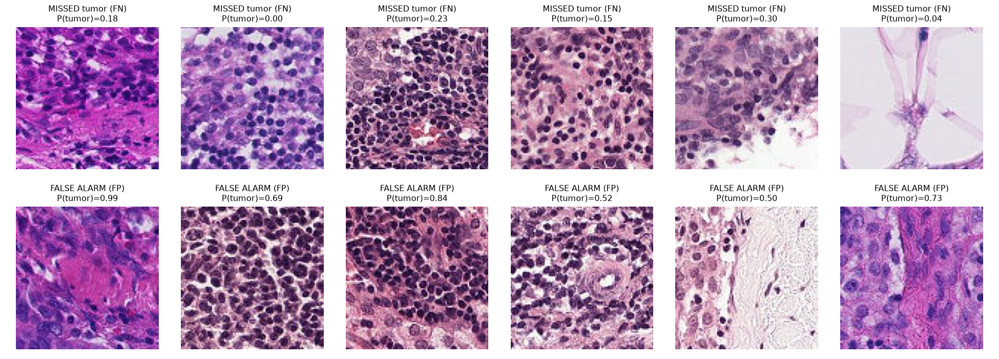
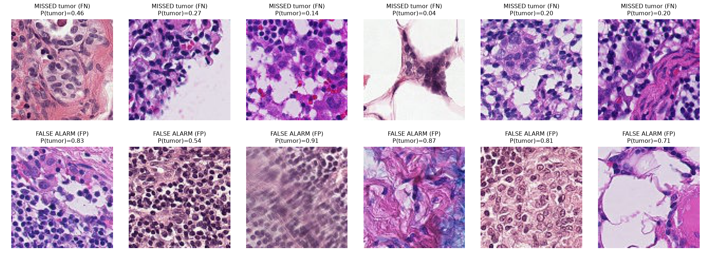

### Grad-CAM
Heatmaps for 4 correct and 4 incorrect test predictions per model (randomly chosen, seeded) are in `results/gradcam_cnn_test.png` and `results/gradcam_resnet18_test.png`. Grad-CAM shows which regions raised the model's tumor score; it is not proof of what the model "understands". In these 8 examples per model: the CNN's heatmaps are small hot spots, often near the edges or corners of the patch rather than the center (including on some wrong predictions); the ResNet18's heatmaps are blank for all four wrong predictions (no region raised its tumor score) and broad on its one correctly detected tumor.

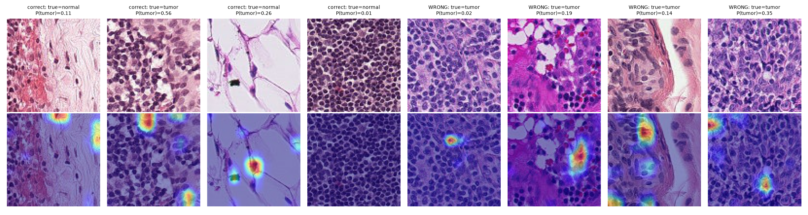
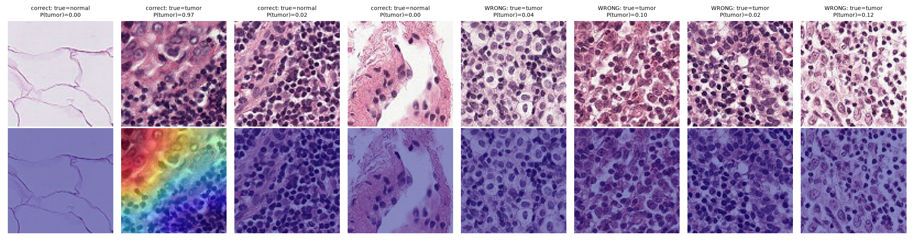

## Limitations
- **Patches, not whole slides.** Each example is a 96x96 crop, so this is not a diagnostic tool and says nothing about how a model would perform on a full slide or in a clinic.
- **Class balance is artificial.** PCam was sampled to be close to 50/50 tumor/non-tumor, so accuracy does not reflect real-world prevalence, where tumor tissue is far rarer.
- **Labels depend only on the center region** of each patch; the surrounding tissue does not determine the label.
- **No external validation.** PCam is derived from 400 slides from the Camelyon16 challenge, so every split comes from the same source.
- **No hyperparameter search**, because of compute limits; 6 epochs, one seed per model.
- **Validation-to-test gap and threshold drift** (see Results) suggest the validation set was an optimistic guide, and the validation-chosen threshold did not transfer exactly.
- **Interpretation caveats:** the confidence intervals ignore training randomness and slide-level correlation; the CNN's Grad-CAM hot spots were often away from the patch center even though the label depends on the center, and the ResNet18's were blank on its wrong predictions. Only 8 examples per model were examined.

## Repo layout
`src/` (data, models, training, threshold choice, evaluation), `scripts/` (download, exploration, local run), `results/` (metrics, per-epoch histories, predictions, plots). Model weights and data are not committed.

## How it was built
I used Claude Code for implementation and made the analysis decisions myself.
